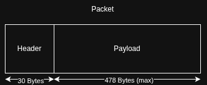
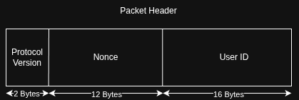

# Packets

## Structure

- Hard limit for the packet size is 508 bytes

- The packets consist of fixed size header + dynamic sized payload. 

- The packet header consists of a 2 bytes protocol version, a 12 bytes nonce and a 16 bytes UUIDv7 user ID.

- Current user's key is matched by the user ID. Key + nonce decrypt the payload.

- Payload can be a chunk of a bigger message, or contain multiple full messages. 

- All messages in a payload, including the non-chunked ones, carry a message_id, the number of chunks of that message, and the index of the current chunk.

- Each message also carries its own header. This header contains a 2 bytes operation code.

- Message body size is dynamic. Body is passed to the function that is mapped by the operation code.

